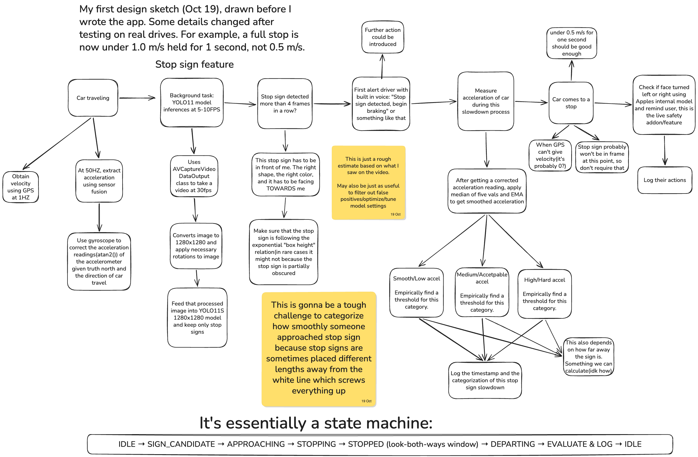

# Full Stop

An iPhone app that coaches new drivers in real time. It uses the phone's camera and motion sensors to catch common beginner mistakes and speaks feedback out loud, so the driver never has to look at or touch the screen. Built for the 2026 Congressional App Challenge.

It is a coaching aid for **supervised** practice. It does not replace the supervising adult, and the driver stays responsible.

## Why

When I learned to drive, my parents were often too busy to teach me, and I drove an old van with no driver-assist features. Now my sister is learning, and our family is just as busy. Washington's Target Zero goal is zero traffic deaths by 2030, and young drivers are one of the highest-risk groups. This app gives every new driver consistent feedback on every drive, and it helps families track the state's 50 required practice hours.

## Features

| Feature | Status |
|---|---|
| Stop sign coach: warns "Stop sign ahead," grades each stop as full, almost stopped, or rolling | Working, tested on real drives |
| "Did you look both ways?" check at stop signs (front camera, head yaw) | Built, still being tested in the car |
| Hard braking / hard acceleration events (accelerometer) | Working |
| Spoken alerts (offline text-to-speech) | Working |
| Report card after each drive | Working |
| Practice hour log: 50 h total / 10 h night, CSV export for parents | Working |
| Drive review: tap a stop or hard brake to jump to that moment in the drive video | Working |
| Night camera mode | Built, not yet tested at night |
| Pedestrian alert | Planned |

## How it works

- **Detection:** a pretrained YOLO11 model (Core ML, via Apple's Vision framework; YOLO11s at 960 px by default, with a smaller battery-saver option in Settings) runs on the phone's Neural Engine at about 6-7 frames per second. It slows down automatically when the phone gets hot.
- **Sensors:** GPS gives speed. Core Motion (50 Hz) measures braking and acceleration and tells when the phone is still.
- **Stop sign coach** ([StopSignCoach.swift](Congressional%20App%20Challenge/Coach/StopSignCoach.swift)): a state machine that combines detections with sensor data. It goes IDLE → SIGN_CANDIDATE → APPROACHING → STOPPING → STOPPED → DEPARTING → EVALUATE. A stop counts as full if the phone is still for 1 s or the GPS speed stays under 1 m/s for 1 s. Otherwise it is graded by the lowest GPS speed: "almost stopped" (at or under 1.3 m/s) or rolling. The middle grade exists because 1 Hz GPS can't reliably tell a very short stop from a slow roll, and the app shouldn't accuse a driver of something it can't measure.
- **Look both ways:** when the car stops at a sign, the app switches to the front camera and uses Vision's face detection to check that the driver turned their head both left and right before leaving.
- **False-alarm filters:** the backs of signs are rejected by how much red the box has ([SignColor.swift](Congressional%20App%20Challenge/Detection/SignColor.swift)). Signs on the left, which are for cross traffic, are rejected by their position in the frame ([SignPosition.swift](Congressional%20App%20Challenge/Detection/SignPosition.swift)).

On the 12 daytime stops from recorded test drives, all 10 real full stops were graded as full stops.

## Design



## Privacy

- All video is processed on the phone and is never uploaded. No account and no network are needed.
- Drive video and sensor data (including GPS routes) stay in the app's own storage. They leave the phone only if the user shares them with the iOS share sheet.

## Project layout

```
Congressional App Challenge/
  Coach/       stop sign state machine (pure Foundation, runs on a Mac too)
  Detection/   camera, YOLO, sign color and position filters
  Drive/       drive session wiring and voice alerts
  Motion/      Core Motion and signal filters
  Recording/   drive video and sensor recording
  LookCheck/   front-camera head tracking (look both ways)
  Log/         report card, practice hour log, sunrise/sunset for night hours
  Screens/     SwiftUI screens
Scripts/       coach tests, replay on recorded drives, drive viewer, model export
```

## Building

You need Xcode and an iPhone (the simulator has no camera). Open `Congressional App Challenge.xcodeproj`, choose your iPhone, and run.

To build from the command line:

```bash
xcodebuild -project "Congressional App Challenge.xcodeproj" -scheme "Congressional App Challenge" -destination 'generic/platform=iOS Simulator' build
```

## Testing

Run the stop sign coach tests on a Mac:

```bash
Scripts/run_coach_test.sh
```

Replay the coach on a recorded drive. This writes `coach.json` into the drive folder:

```bash
Scripts/run_coach_replay.sh "DriveData/<drive folder>"
```

The drive viewer shows the video with sensor graphs, coach phases and passenger marks. It needs the Python packages in `Scripts/model-requirements.txt`:

```bash
python Scripts/drive_viewer.py "DriveData/<drive folder>"
```

The model files can be re-exported with `python Scripts/export_model.py`.

All real-car testing was done with a parent driving, or with the student driving and a parent supervising from the passenger seat.
